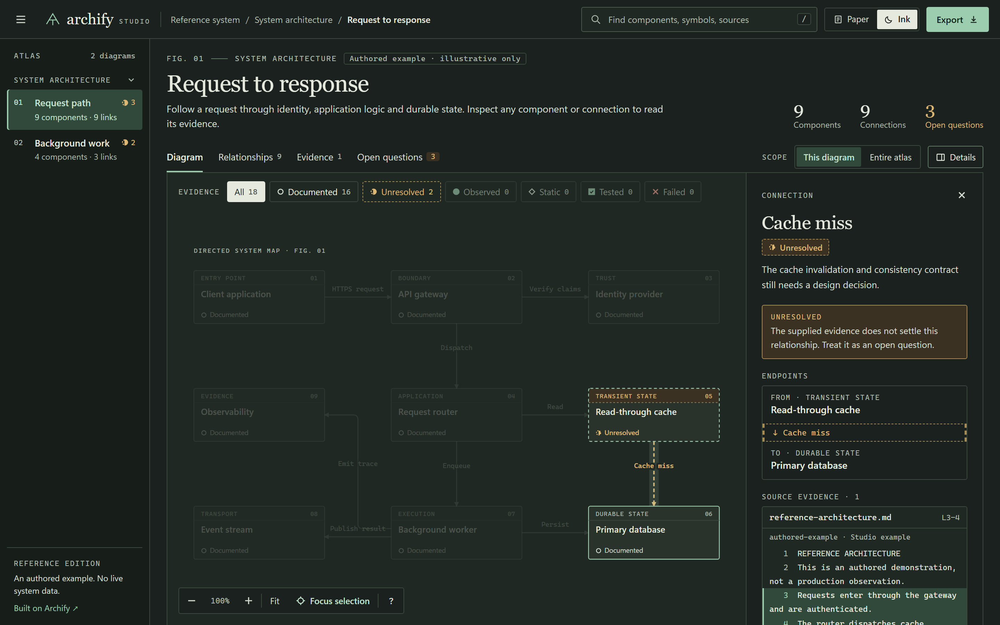
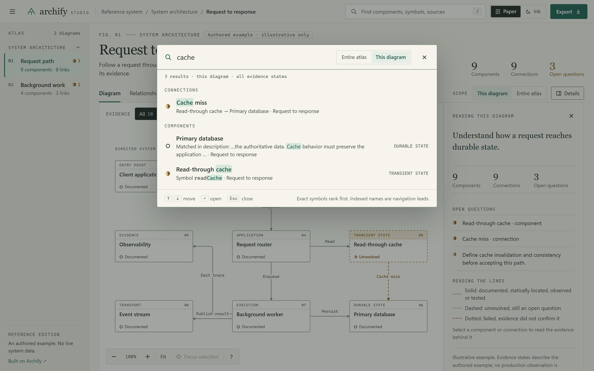
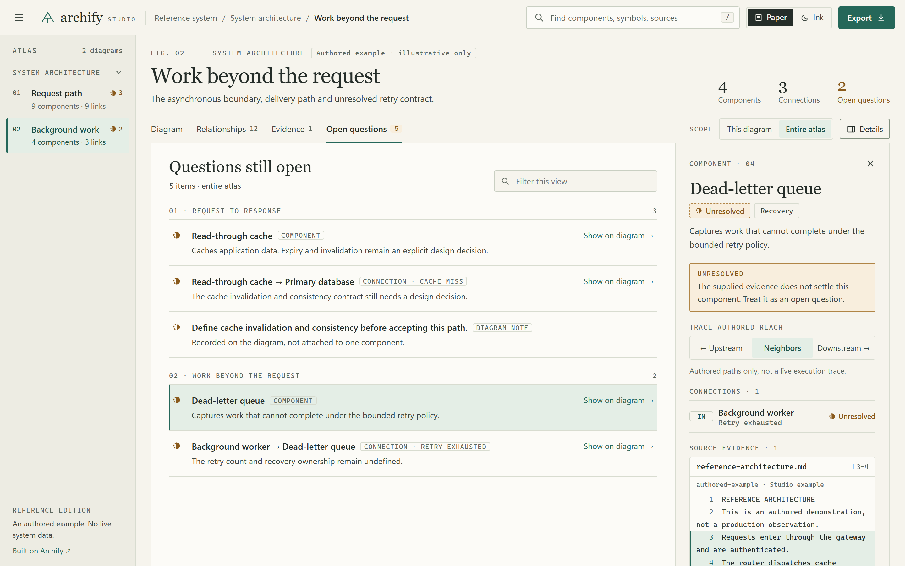
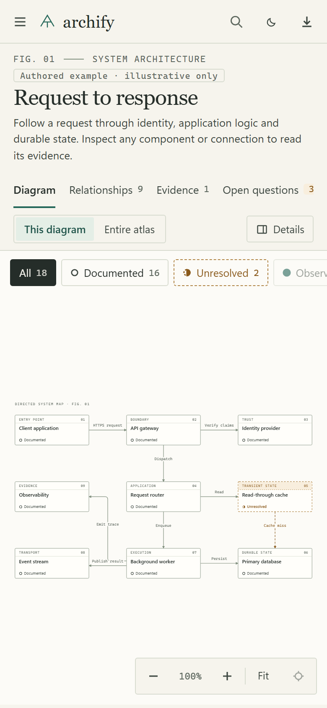
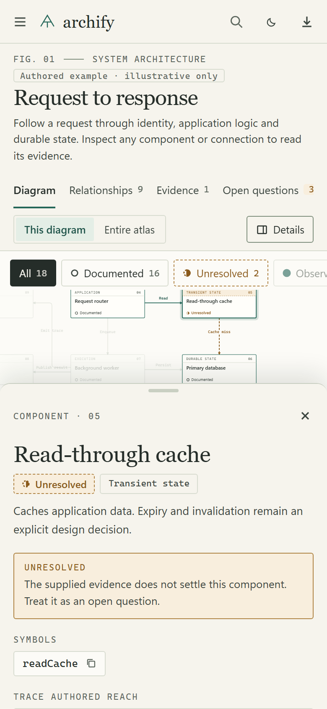

# Archify Studio

An offline workspace for architecture diagrams and the evidence behind them. An independently maintained derivative of [Archify](https://github.com/tt-a1i/archify), pinned to 3.0.1 / `73aaa069`.

Studio adds a drawing-desk visual system, Paper and Ink themes, persistent diagram state, grouped navigation, scoped search, docked evidence inspection, exact source excerpts, open-question views, and portable SVG/HTML export. It uses plain CSS, SVG and browser APIs. The browser artifact has no external runtime dependencies; Studio adds no npm or Python package dependencies.

## Screenshots

These show the bundled authored example, not production data.


<table>
  <tr>
    <td width="50%"></td>
    <td width="50%"></td>
  </tr>
  <tr>
    <td align="center">Ink theme, a connection selected</td>
    <td align="center">Search groups results and says why each matched</td>
  </tr>
</table>



<p align="center">
  
  &nbsp;&nbsp;
  
</p>

```powershell
npm run check
npm run build
npm start
```

Open http://127.0.0.1:43127 or open `dist/index.html` directly in a browser. Node.js 22+ is required to build. The default artifact is a labeled authored example, not production data.

- [Operations and private atlas import](studio/RUNBOOK.md)
- [Design contract](studio/DESIGN.md)
- [Project design skill](.agents/skills/archify-studio-design/SKILL.md)
- [Standards skill](.agents/skills/archify-standards/SKILL.md) and [scoped standards contract](studio/contracts/STANDARDS.md)
- [Python packaging contract and example](studio/contracts/atlas-input-v1.md)
- [Engineering RFC template](studio/rfcs/TEMPLATE.md)
- [Upstream provenance and boundary](studio/UPSTREAM.md)
- [Original upstream README](UPSTREAM_README.md)

Private research artifacts belong in ignored `.local/` or a separate output directory. A portable research atlas embeds its source text: review before sharing. Studio currently imports architecture/evidence-atlas inputs; upstream retains its separate five-mode rendering tools. Local test, real browser, upstream, and hosted CI evidence are separate.

For reusable Python packaging, install Python 3.11+ alongside Node.js 22+; no additional Python packages are required:

```powershell
npm run check:all
python studio/tools/package_atlas.py --model studio/examples/atlas-model.json --source-root studio/examples --out .local/example-packet
node studio/build.mjs --atlas .local/example-packet --out .local/example-atlas.html
```

The standards contract maps JSON, HTTP, URL, accessibility, SVG and source-evidence requirements to automated checks or explicit manual qualification. Passing its enforced subset is not a blanket compliance certification. Original bespoke Python research-authoring scripts remain outside this reusable source tree; the committed Python packager consumes reviewed model data instead of embedding research claims.

## License

MIT. Original Archify and Cocoon AI notices are retained in [LICENSE](LICENSE); see [THIRD_PARTY_NOTICES.md](THIRD_PARTY_NOTICES.md). Studio artifacts embed the upstream license. This repository does not claim endorsement by upstream maintainers.
